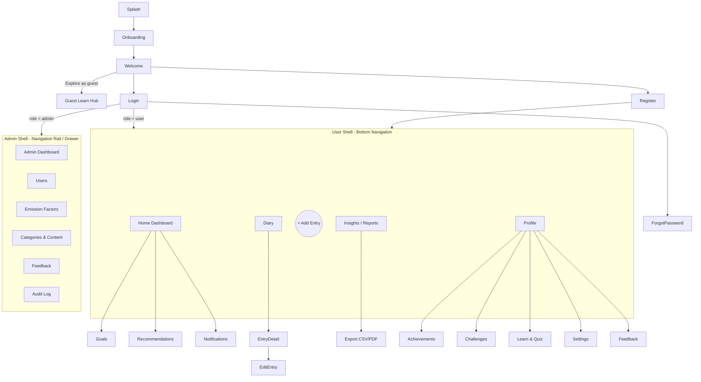
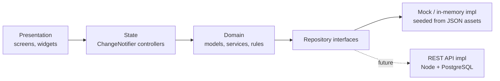
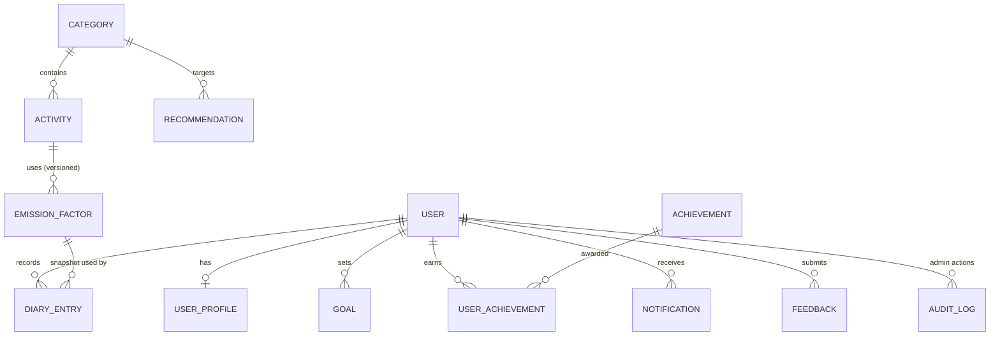

# CFootNote — Project Plan

**Product:** CFootNote, a carbon footprint diary
**Platform:** Flutter (Android first; iOS and web come with the same codebase)
**Toolchain:** Flutter 3.50 / Dart 3.14, `material_ui` (decoupled Material library)
**Document version:** 1.0, 19 Nov 2026
**Status:** Draft, waiting for approval

---

## 1. Purpose and Scope

CFootNote helps people record everyday activities, estimate the emissions those activities cause in kilograms of CO₂ equivalent (kg CO₂e), track progress against goals, and get practical suggestions for cutting emissions. It also gives administrators tools to manage emission factors and content.

This build is for **Practical 1: UI Design**. The main deliverable is a polished, fully navigable, interactive UI for all three user roles (Guest, Registered User, Administrator). Behind the UI sits a clean layered architecture with a working calculation engine and local mock data. Because the data layer sits behind interfaces, a real backend (Node.js/Express + PostgreSQL, as the requirements suggest) can replace it later without touching the UI.

### 1.1 In scope (this iteration)
| Area | Delivered |
|---|---|
| Visual design system | Colour palette, typography scale, spacing, shapes, elevation, light and dark themes, reusable components |
| Guest flow | Splash, onboarding, learn hub, tips, login, register, forgot password |
| User flow | Dashboard, diary (add / view / edit / delete / search / filter / sort), reports & charts, goals, recommendations, learn & quiz, achievements, challenges, notifications, profile, settings, feedback |
| Admin flow | Admin dashboard, user management, categories, emission factors (with version history), content/tips, feedback review, audit log |
| Logic | Unit conversion, emission calculation (`activity × factor`), goal progress/status, rule-based recommendations, badge rules |
| Data | In-memory repositories seeded from JSON assets (emission factors are kept separate from code) |
| Export | CSV export of reports (PDF is marked as a stretch goal) |
| Tests | Unit tests for calculations, conversions, validation, goal status, badge and recommendation rules; widget smoke tests |

### 1.2 Out of scope (later iterations)
Real backend and authentication server, push/email delivery, password hashing on a server, cloud deployment, social sharing, leaderboards, device integrations, ML predictions.

> **Note:** The practical PDF (`Practical 1 - UI Design SEPT 2026 (1).pdf`) could not be parsed automatically. This plan follows the written requirements. Any marking criteria from the PDF (for example, a required number of screens, specific widgets, or wireframe deliverables) still need to be merged into §9 and §12.

---

## 2. Design Vision: "Calm, Hopeful, Clear"

The app should feel calm and encouraging, never guilt-inducing. Every number on screen is an **estimate** and is labelled that way ("≈ 3.6 kg CO₂e, estimated").

### 2.1 Colour palette ("Forest & Mint")
| Token | Light | Dark | Usage |
|---|---|---|---|
| `primary` | `#1E6B4E` Forest | `#5FD3A0` | Main actions, active nav |
| `primaryContainer` | `#CFF5E3` | `#0F3D2C` | Hero cards, chips |
| `secondary` | `#3DDC97` Mint | `#3DDC97` | Highlights, progress |
| `tertiary` | `#4FA3F7` Sky | `#8CC4FF` | Info, water |
| `surface` | `#F7F6F1` Sand | `#0E1512` | Background |
| `surfaceCard` | `#FFFFFF` | `#16201B` | Cards |
| `warning` | `#FFB547` Amber | `#FFC870` | At-risk states |
| `error / high` | `#F0605D` Coral | `#FF8A85` | High emissions, destructive |

**Category accent colours** (always shown together with an icon and a text label, so colour is never the only cue, per NFR-07):
Transport `#4FA3F7` · Electricity `#FFB547` · Food `#F28C5B` · Waste `#8D7BF0` · Water `#3EC6E0` · Shopping `#E66FA8` · Household fuel `#C9785A` · Custom `#7A8C84`

### 2.2 Typography
- Font: system default (Roboto on Android) with a tuned type scale. Optional upgrade: bundled "Plus Jakarta Sans".
- Display numbers (emission totals) use tight letter spacing and weight 700, so the key figures stand out.
- Body text is at least 14 sp, and text scales with system accessibility settings.

### 2.3 Shape, spacing, motion
- 8-pt spacing grid; screen padding of 20.
- Corner radius: cards 24, inputs 16, chips 12, buttons fully rounded (stadium).
- Soft, low-contrast shadows in light mode; tonal elevation in dark mode.
- Motion: 200–350 ms ease-out-cubic, animated counters for totals, animated ring and progress fills, Hero transitions from an entry tile to its detail page, staggered list fade-ins.

### 2.4 Signature components
| Component | Description |
|---|---|
| `CarbonRing` | Animated circular gauge showing today's total against the daily budget, using a gradient stroke |
| `GradientHeroCard` | Forest→Mint gradient header card on the dashboard |
| `StatTile` | Small metric card with value, unit, trend arrow, and % change against the previous period |
| `CategoryChip` / `CategoryAvatar` | Icon + label + accent colour |
| `EntryTile` | Diary row showing category avatar, description, quantity, kg CO₂e, and date |
| `TrendLineChart`, `CategoryBarChart`, `DonutChart` | Custom-painted charts with no third-party dependency, so they stay compatible with `material_ui` |
| `GoalProgressCard` | Linear progress bar with status pill (On track / At risk / Above target / Completed) |
| `BadgeMedal` | Earned badges in colour, locked badges in grey with a lock icon |
| `EmptyState` | Illustration icon, a friendly message, and a call to action |
| `ConfirmDialog` | Shown before any destructive action (NFR-06) |

---

## 3. Information Architecture and Navigation



- **User shell:** a bottom `NavigationBar` with a centre docked "Add" FAB. Destinations: Home · Diary · (+) · Insights · Profile.
- **Admin shell:** a `NavigationRail` on wide screens and a `NavigationDrawer` on phones (adaptive, per NFR-08).
- Routing uses named routes through a central `AppRouter` (no extra package).

---

## 4. Screen Inventory (about 35 screens)

| # | Screen | Role | Requirement(s) |
|---|---|---|---|
| 1 | Splash | All | — |
| 2 | Onboarding (3 pages) | Guest | 2.1 |
| 3 | Welcome | Guest | 2.1 |
| 4 | Guest Learn Hub / Tips | Guest | 2.1, FR-12 |
| 5 | Login (Remember me, lockout message) | Guest | FR-02 |
| 6 | Register (full validation, password strength meter, T&C) | Guest | FR-01 |
| 7 | Forgot password / Reset | Guest | FR-02 |
| 8 | Home Dashboard | User | FR-07 |
| 9 | Diary list (search, filter sheet, sort, incremental load) | User | FR-04, FR-09 |
| 10 | Add Entry, step 1: Category picker | User | FR-04, §4 |
| 11 | Add Entry, step 2: Activity form + live CO₂e preview | User | FR-04, FR-05 |
| 12 | Entry detail (factor, source, version shown) | User | FR-04, FR-05 |
| 13 | Edit entry (with optional recalculation) | User | FR-04, FR-05 |
| 14 | Custom activity form (user-provided factor badge) | User | §4.8 |
| 15 | Insights / Reports (day/week/month/year/custom) | User | FR-08 |
| 16 | Export report sheet | User | FR-08 |
| 17 | Goals list | User | FR-10 |
| 18 | Create / Edit goal | User | FR-10 |
| 19 | Recommendations | User | FR-11 |
| 20 | Learn & Tips articles | User | FR-12 |
| 21 | Quiz | User | FR-12 |
| 22 | Achievements & points | User | FR-13 |
| 23 | Challenges list + detail | User | FR-14 |
| 24 | Notifications centre | User | FR-15 |
| 25 | Profile | User | FR-03 |
| 26 | Edit profile (incl. household / vehicle / diet) | User | FR-03 |
| 27 | Settings (units, theme, notifications, reminder time) | User | FR-03, FR-15 |
| 28 | Change password / Delete account | User | FR-02, FR-03 |
| 29 | Feedback form | User | FR-19 |
| 30 | Privacy Policy & Terms | All | NFR-03 |
| 31 | Admin Dashboard | Admin | FR-16 |
| 32 | User management (search, suspend, role) | Admin | FR-17 |
| 33 | Emission factors list + editor + version history | Admin | FR-06 |
| 34 | Categories / Tips / Challenges / Badges content | Admin | FR-18 |
| 35 | Feedback review + respond | Admin | FR-19 |
| 36 | Audit log | Admin | NFR-02 |

---

## 5. Architecture

### 5.1 Layering (NFR-09)


- **State management:** Flutter's built-in `ChangeNotifier`, exposed through an `InheritedNotifier`-based `AppScope`. There are no third-party state packages, which keeps the app compatible with `material_ui`.
- **Dependency injection:** one `ServiceLocator` builds the repositories and services at startup.
- **Emission factors** live in `assets/data/emission_factors.json`, not in code. Each factor carries its source, publication year, version, and effective date (FR-05, FR-06).

### 5.2 Folder structure
```
lib/
  main.dart
  app/            app.dart, router.dart, app_scope.dart, service_locator.dart
  core/
    theme/        colors.dart, typography.dart, theme.dart, spacing.dart
    widgets/      carbon_ring, gradient_card, stat_tile, charts/, empty_state, ...
    utils/        formatters.dart, validators.dart, unit_converter.dart
  domain/
    models/       user, profile, category, activity, emission_factor, diary_entry,
                  goal, recommendation, achievement, challenge, notification,
                  feedback, audit_log
    services/     carbon_calculator, goal_evaluator, recommendation_engine,
                  badge_engine, report_service, csv_exporter
  data/
    repositories/ *_repository.dart (interfaces)
    mock/         mock_*_repository.dart, seed_data.dart
  features/
    onboarding/ auth/ dashboard/ diary/ reports/ goals/ recommendations/
    learn/ achievements/ challenges/ notifications/ profile/ settings/
    feedback/ admin/
assets/data/      emission_factors.json, tips.json, quiz.json
test/             unit + widget tests
```

### 5.3 Domain model (matches the database spec in §13 of the requirements)


---

## 6. Calculation Engine (FR-05)

```
emission_kgCO2e = convertToBaseUnit(quantity, unit) × factor.value
```

1. **Normalise the unit:** mi→km, lb→kg, gal→L, min→h, servings→kg (using each activity's serving weight).
2. **Resolve the factor:** pick the active factor matching activity + user region whose effective date is on or before the entry date. If there is no regional match, fall back to the global factor.
3. **Adjust where needed:**
   - Transport: per-passenger share for car or taxi (`÷ passengers`). Round-trip flights count ×2.
   - Electricity: `× (1 − renewable%)`.
4. **Calculate and round:** the stored value keeps full precision; the display rounds to 2 decimals.
5. **Snapshot the factor:** each entry stores `factorId`, `factorValue`, `factorVersion`, and `effectiveDate`, so editing a factor later never changes old entries silently. On the entry detail screen, the user can choose "Recalculate with latest factor".
6. **Avoided emissions:** recycling and composting are stored as a separate `avoidedKg` field and are never subtracted from totals.
7. **Custom factors** are tagged `isUserProvided = true` and shown with a "User-provided factor" badge.

**Seed factors** are illustrative values based on public datasets (for example, UK DEFRA/DESNZ GHG Conversion Factors and IPCC defaults). The Malaysia electricity grid factor still needs to be checked against Suruhanjaya Tenaga / MGTC publications. Every factor shows its source in the UI.

---

## 7. Business Rules

| Rule | Logic |
|---|---|
| Goal status (FR-10) | progress = actual ÷ target over the elapsed period. **Completed** if the period has ended and actual ≤ target. **Above target** if actual > target. **At risk** if the projected end-of-period value > 90% of target. Otherwise **On track**. |
| Recommendations (FR-11) | Rule table keyed by highest category, frequency of certain entries (e.g. ≥3 food-waste entries in 7 days), profile (vehicle type, diet), and goal status. Wording is always a suggestion ("You could try…"). |
| Badges (FR-13) | First Diary Entry · Seven-Day Streak · Low-Carbon Traveller (5 bike/walk/train trips) · Energy Saver (electricity down 10% week over week) · Waste Reducer · Goal Achiever |
| Points | +5 per entry, +20 streak day 7, +50 goal met, +10 quiz completed. The app never claims an action "offsets" emissions. |
| Login lockout (FR-02) | 5 failed attempts trigger a 60-second cooldown (simulated on the client). |
| Password strength (FR-01) | ≥ 8 characters, including upper, lower, digit, and symbol. A live strength meter is shown. |

---

## 8. Dependencies

Dependencies are kept to a minimum on purpose:

| Package | Purpose | Note |
|---|---|---|
| `material_ui` | Material widgets | Already present |
| `intl` | Date and number formatting | Pure Dart |
| `shared_preferences` *(optional)* | Persist the "Remember me" session, theme, and settings | Platform plugin |
| `share_plus` / `path_provider` *(optional)* | Share an exported CSV | Only added if it is compatible with Flutter 3.50 |

Charts, rings, and illustrations are custom-painted, so no chart library is needed.

---

## 9. Requirements Traceability (summary)

| Requirement | Where it is satisfied |
|---|---|
| FR-01 / FR-02 | `features/auth` + `core/utils/validators.dart` |
| FR-03 | `features/profile`, `features/settings` |
| FR-04 / FR-09 | `features/diary` (list, filter sheet, add/edit/detail) |
| FR-05 / FR-06 | `domain/services/carbon_calculator.dart`, `assets/data/emission_factors.json`, `features/admin/factors` |
| FR-07 | `features/dashboard` |
| FR-08 | `features/reports`, `domain/services/report_service.dart`, `csv_exporter.dart` |
| FR-10 | `features/goals`, `goal_evaluator.dart` |
| FR-11 / FR-12 | `recommendation_engine.dart`, `features/recommendations`, `features/learn` |
| FR-13 / FR-14 | `badge_engine.dart`, `features/achievements`, `features/challenges` |
| FR-15 | `features/notifications`, settings toggles |
| FR-16 – FR-19 | `features/admin/*`, `features/feedback` |
| NFR-06 / NFR-07 | Design system, semantics labels, confirm dialogs, contrast-checked palette |
| NFR-09 | Layered architecture, tests |

---

## 10. Implementation Phases

| Phase | Deliverable | Exit criteria |
|---|---|---|
| **P0 Foundation** | Theme, design tokens, core widgets, router, app scope, models, seed data | App launches with themed shell; `flutter analyze` is clean |
| **P1 Guest & Auth** | Splash, onboarding, welcome, learn hub, login, register, forgot password | Validation works; demo accounts can log in as user and as admin |
| **P2 Diary & Calculator** | Category picker, activity forms for 8 categories, live CO₂e preview, list, detail, edit, delete, search/filter/sort | Calculations match the unit tests; deletes ask for confirmation |
| **P3 Dashboard & Insights** | Carbon ring, stat tiles, charts, period comparison, reports, CSV export | Charts render seeded data for every period |
| **P4 Goals, Recs, Gamification** | Goals CRUD + status, recommendations, badges, points, challenges, learn & quiz, notifications | Status pills and badges are correct for seeded scenarios |
| **P5 Profile & Settings** | Profile, edit, units, theme toggle, notification prefs, password change, delete account, feedback, privacy | Unit switch updates all displays |
| **P6 Admin** | Admin dashboard, users, factors (add/edit/deactivate/versions), content, feedback, audit log | Editing a factor writes an audit entry and does not change past entries |
| **P7 Polish & QA** | Animations, empty states, dark mode pass, accessibility labels, tests, README | All tests pass; manual run-through on an Android emulator |

---

## 11. Testing Strategy

- **Unit:** `carbon_calculator_test` (the 20 km × 0.18 = 3.60 example, passengers, round trip, renewable %), `unit_converter_test`, `validators_test`, `goal_evaluator_test`, `badge_engine_test`, `recommendation_engine_test`.
- **Widget:** login validation, add-entry flow updates the dashboard total, delete confirmation dialog.
- **Manual system test:** the full workflow listed in §15 of the requirements.

---

## 12. Acceptance Criteria

1. The app launches as **CFootNote** with a consistent, polished design in light and dark mode.
2. A guest can browse tips, register, and log in. Demo accounts:
   - `user@cfootnote.app` / `Demo@1234`
   - `admin@cfootnote.app` / `Admin@1234`
3. A user can add an entry in **3 taps or fewer after choosing a category** and see the estimated kg CO₂e right away.
4. The dashboard shows today / week / month totals, goal progress, the top category, a comparison, recent entries, and recommendations.
5. Reports show every period with a category breakdown and export to CSV.
6. An admin can manage emission factors with full source and version details, and the change is logged.
7. All destructive actions ask for confirmation, and all icons have text or semantic labels.
8. `flutter analyze` reports no errors and `flutter test` passes.

---

## 13. Risks and Mitigations

| Risk | Mitigation |
|---|---|
| `material_ui` decoupling breaks third-party UI packages | Custom-painted charts; minimal dependencies |
| Emission factor accuracy | Factors in JSON with source and version; "estimate" disclaimer shown in the UI |
| Scope size | Phased delivery; MVP items (§17 of the requirements) first |
| No real backend | Repository interfaces allow an API implementation to be dropped in later |
